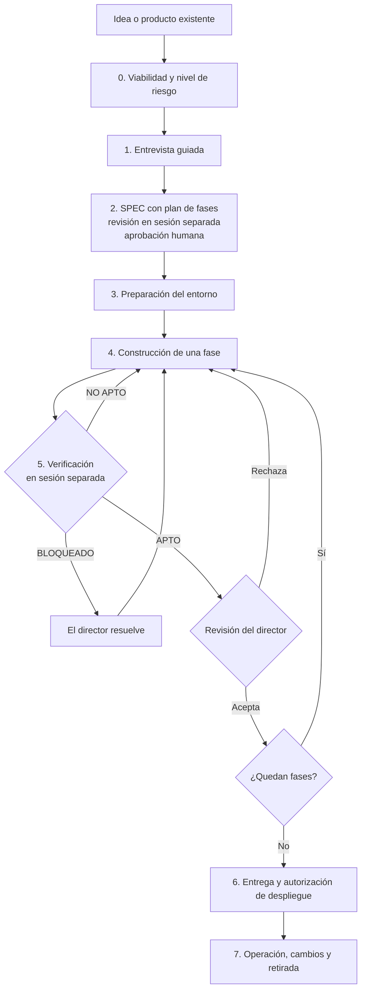

# DDEC — Desarrollo Dirigido por Especificación Conversacional

> *Primero el plano, después la obra.*

**DDEC** es una metodología abierta para construir software con agentes de IA (Claude Code, Codex u otros) de forma predecible. La IA escribe la mayor parte del código; el humano decide, especifica y valida. El centro del trabajo deja de ser el código y pasa a ser un **acuerdo de requisitos comprobables**: la especificación.


📄 **Documento completo:** [`docs/DDEC_v0.4_Metodologia_Completa.md`](docs/DDEC_v0.4_Metodologia_Completa.md)

---

## ¿Por qué DDEC?

Programar con IA a base de prompts sueltos (*vibe coding*) funciona para prototipos, pero falla cuando el proyecto crece: alcance ambiguo, retrabajo, decisiones que el agente inventa y código que nadie ha verificado de verdad.

DDEC propone un ciclo explícito:

**entrevista → especificación → aprobación → construcción por fases → verificación independiente → aceptación humana**

Sus rasgos principales:

- **Entrevista guiada.** La IA obtiene los requisitos preguntando en rondas cortas con opciones concretas y una recomendación razonada. Sirve también para directores sin perfil técnico.
- **Nadie da por bueno su propio trabajo.** Quien construye no verifica: un agente distinto, en una sesión separada, prueba contra la especificación y emite un dictamen. La aceptación final es siempre humana.
- **Proporcional al riesgo.** Tres niveles (rápido, estándar y completo) con umbrales mínimos obligatorios según datos, pagos o impacto.
- **Independiente de la herramienta.** Ficheros Markdown portables; no exige proveedor, modelo, lenguaje ni IDE.
- **Ciclo de vida completo.** De la viabilidad inicial a la operación, el mantenimiento y la retirada, incluidos productos ya existentes.

## Los siete principios

1. La especificación aprobada es la referencia acordada.
2. El humano conserva la autoridad sobre las decisiones.
3. Se especifica lo necesario antes de construir.
4. La entrevista facilita decisiones informadas.
5. La construcción avanza en fases verificables.
6. Nadie da por bueno su propio trabajo.
7. La supervisión y la seguridad son proporcionales al riesgo.

## Roles

| Rol | Quién | Qué hace |
| --- | --- | --- |
| **Director** | Humano | Aprueba el SPEC, el nivel, los cambios, cada fase y los despliegues |
| **Analista** | IA conversacional | Entrevista, detecta riesgos y redacta la especificación |
| **Constructor** | Agente de código | Implementa una fase aprobada cada vez |
| **Verificador** | Agente en sesión separada | Prueba contra el SPEC, aporta evidencias y emite dictamen; nunca corrige el código |

## Ciclo de vida



Cuando un fallo se debe a la especificación o a un cambio de alcance, pasa por el protocolo de cambios y la aprobación del director antes de volver a construcción.

## Niveles de aplicación

| Nivel | Uso típico | Verificación |
| --- | --- | --- |
| **Rápido** | Prototipo, landing, automatización de bajo riesgo | Sesión separada y aceptación humana |
| **Estándar** | Web o aplicación de negocio | Por fase, con evidencias, regresión e identificadores de requisitos |
| **Completo** | Sistemas críticos o datos especialmente protegidos | Otro modelo o herramienta, apoyo experto y trazabilidad auditable |

El tamaño no equivale al riesgo. Tratar datos personales, procesar pagos o acceder a producción fija como mínimo el nivel **estándar**. Tratar categorías especiales de datos, datos de menores o sistemas con impacto grave fija el nivel **completo**.

## Artefactos

Todos son ficheros Markdown en la raíz del repositorio del proyecto. En nivel rápido, varios se integran como secciones del SPEC.

| Fichero | Función |
| --- | --- |
| `VIABILIDAD.md` | Justificación, nivel, riesgos y estimación; base para un presupuesto |
| `SPEC.md` | Requisitos, criterios de aceptación, plan de fases y versión aprobada |
| `AGENTS.md` | Reglas, límites, comandos y escalado para los agentes |
| `INFORME_VERIFICACION.md` | Pruebas, evidencias y dictamen por fase |
| `DECISIONES.md` / `CAMBIOS.md` | Registro de decisiones y solicitudes de cambio |
| `TRAZABILIDAD.md` | Mapa requisito → criterio → prueba (nivel completo) |
| `OPERACION.md` | Despliegue, recuperación y monitorización (condicional) |
| `CLAUDE.md` u otros | Adaptadores opcionales por herramienta |

## Empezar en cinco minutos

1. **Abre una conversación con tu IA** y usa el prompt de analista (§10 del documento):

   ```text
   Actúa como ANALISTA DDEC. Idea: [descripción]. Usuarios: [quiénes].
   Nivel inicial: [rápido/estándar/completo o por determinar].
   Entrevístame por rondas de 3-4 preguntas relacionadas, con opciones
   concretas, una recomendación justificada y la opción «Otra».
   No inventes respuestas. Al finalizar, redacta el SPEC con su plan de
   fases. No consideres aprobado ningún documento sin mi confirmación.
   ```

2. **Revisa el borrador del SPEC en otra sesión** y apruébalo tú.
3. **Encarga una sola fase** al agente de código con el prompt de constructor (§11.1).
4. **Verifica en una sesión nueva**, sin el historial del constructor, con el prompt de verificador (§11.2).
5. **Prueba tú el resultado** y cierra la fase. Repite hasta terminar.

## Conformidad

Un proyecto puede **autodeclararse** «desarrollado siguiendo DDEC v0.4, nivel X» si cumple los 13 criterios de §17 del documento. Es una declaración de seguimiento del proceso: **no es una certificación** ni garantiza la calidad, la seguridad o el cumplimiento legal del producto.

## Estado del proyecto

DDEC v0.4 es una **versión candidata**, pendiente de validación externa. No afirma superioridad frente a otras metodologías de *spec-driven development* como GitHub Spec Kit, Kiro, BMAD Method u OpenSpec; se sitúa en esa misma familia.

Hoja de ruta hacia la primera versión pública:

- [x] Texto normativo de la metodología (v0.4)
- [ ] Kit de plantillas con ejemplos rellenados
- [ ] Tres casos prácticos documentados (bajo riesgo, aplicación estándar y evolución de un producto existente), incluidos los resultados negativos
- [ ] Revisión por usuarios externos
- [ ] Verificación del estado del arte, las licencias y las atribuciones

## Estructura del repositorio

```text
.
├── README.md
├── LICENSE                 # CC BY 4.0 para la documentación
├── docs/
│   └── DDEC_v0.4_Metodologia_Completa.md
├── plantillas/             # Kit oficial (en preparación)
├── prompts/                # Prompts de analista, constructor y verificador
└── casos/                  # Casos prácticos documentados (en preparación)
```

## Contribuir

Las propuestas son bienvenidas. Abre un *issue* para plantear dudas, incoherencias o mejoras, indicando la sección afectada (por ejemplo, §5.6). Los cambios en el texto normativo se registran en §18 del documento, con su decisión y su motivo.

## Licencia

La documentación se distribuye bajo **[Creative Commons Atribución 4.0 (CC BY 4.0)](https://creativecommons.org/licenses/by/4.0/deed.es)**: puedes usarla, adaptarla y compartirla, incluso con fines comerciales, siempre que cites la autoría. Las plantillas y el código de ejemplo tendrán su propia licencia de software, que se indicará en sus carpetas.

## Autor

**Jose Tomás Caballero García**

---

*DDEC — Primero el plano, después la obra.*
